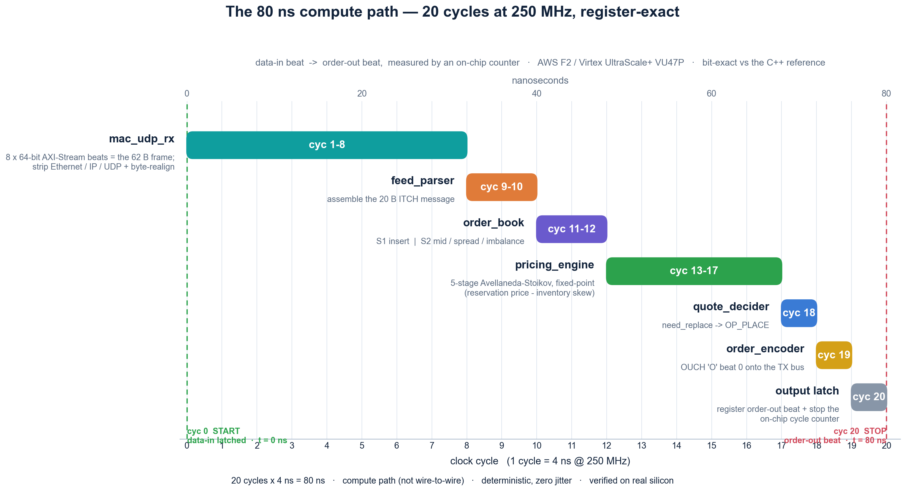
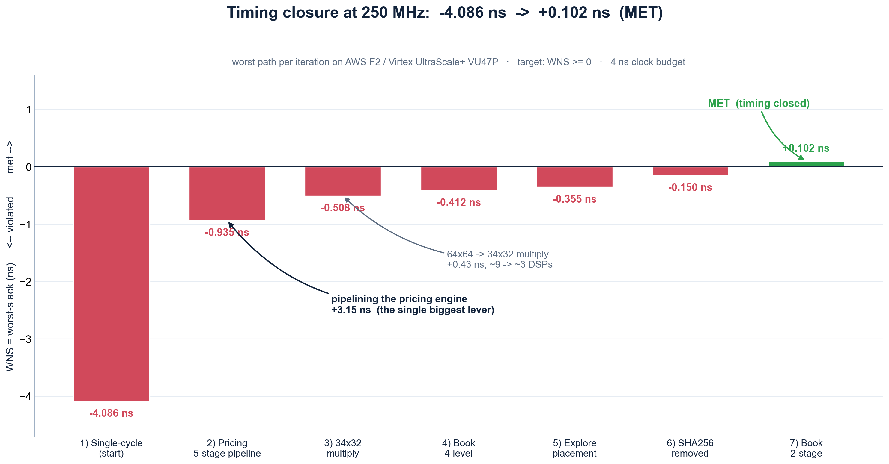

# GEL — a strategy-agnostic FPGA execution platform

[](https://github.com/rapoyrazoglu/gel-fpga-trading/actions/workflows/ci.yml)
[](LICENSE)


An ITCH market-data event enters, an OUCH order leaves **80 ns of on-chip
compute later**: 20 cycles at 250 MHz, measured by an on-chip counter on an AWS
F2 instance (Virtex UltraScale+ VU47P), timing closed, hardware bit-exact
against the C++ reference. That is the **compute path**, not a wire-to-wire
exchange loop — see [Measurement and scope](#measurement-and-scope).

One pricing function is the single source of truth. It compiles as host C++,
synthesises through Vitis HLS, and is mirrored in VHDL; tests prove all three
produce the same bits.

```cpp
// Market-Maker/host/pricing/pricing_engine.h — integer-only, no UB, HLS-ready
const int64_t prod = qc * static_cast<int64_t>(p.inv_skew_q31);   // inventory x Q1.31 skew
const int64_t skew = (prod + (1LL << 30)) >> 31;                  // round to nearest, no divide
const int64_t r    = static_cast<int64_t>(s) - skew;              // reservation price
out.bid = sat_i32(r - p.half_spread - p.bid_skew_ticks);          // saturate, never wrap
out.ask = sat_i32(r + p.half_spread + p.ask_skew_ticks);
```



## Try it

No FPGA, no cloud account and no third-party libraries needed:

```sh
git clone https://github.com/rapoyrazoglu/gel-fpga-trading && cd gel-fpga-trading
cmake -B build && cmake --build build -j && ctest --test-dir build   # 15 tests
tools/run_offline_regression.sh        # adds the engine demos + 23 GHDL testbenches
```

Or open [`docs/demo/fpga_demo.html`](docs/demo/fpga_demo.html) in a browser: it
runs the same fixed-point math that is compiled to the FPGA.

## What is in here

| Directory | What it is |
|---|---|
| [`connector/`](connector/) | Header-only SDK between strategies and the engine: 64-byte wire structs, lock-free SPSC ring, cross-process mmap ring, `IStrategy` |
| [`GEL/`](GEL/) | The C++23 execution engine: per-strategy rings, pre-trade risk, OUCH encoding, routing, drop-copy |
| [`Market-Maker/`](Market-Maker/) | MMX, an Avellaneda–Stoikov market maker: host slow path, HLS pricing kernel, and the VHDL data plane with its testbenches |
| [`docs/`](docs/) | Tutorial, how-to guides, explanations, reference |

## Results on silicon (AWS F2 / VU47P)

| Block | Result |
|---|---|
| Full data plane | 80 ns (20 cycles at 250 MHz), timing met at +0.102 ns |
| Host to FPGA parity | bit-exact on 500 / 500 vectors |
| Simulation | 23 / 23 GHDL testbenches, 12 of them mutation tests |
| Smart pricing (imbalance + volatility + circuit breaker) | 16 ns |
| Hardware backtester | BRAM tick replay with mark-to-market PnL, timing met at +0.335 ns |
| Footprint of the pricing kernel | 474 LUT, 461 FF, 4 DSP — under 0.05 % of the device |

Timing started at −4.086 ns of slack. The largest single win was a skew
multiply that had been declared 64x64; the operands only need 34x32. The story
is in [docs/explanation/timing-closure.md](docs/explanation/timing-closure.md).



## Measurement and scope

- **80 ns is on-chip compute**: data-in beat to order-out beat. NIC, cabling and
  distance to a venue are outside it.
- The market-data feed is **host-injected**. There is no live venue and no
  co-location.
- The silicon build **omits the HMAC check** on the parameter block to close
  timing. HMAC is verified in simulation only.
- The engine's own unit-test binary has known failures; they are listed in
  [docs/reference/test-status.md](docs/reference/test-status.md).
- This is competitive with production FPGA trading systems on compute latency,
  not superior to them. Their moat is alpha, scale and bespoke hardware.

## Documentation

Start at [docs/README.md](docs/README.md). The short version:

- New here: [write your first strategy](docs/tutorials/first-strategy.md)
- Have a task: [run the regression](docs/how-to/run-the-regression.md),
  [reproduce on AWS F2](docs/how-to/reproduce-on-aws-f2.md),
  [add a mutation test](docs/how-to/add-a-mutation-test.md)
- Want the why: [architecture](docs/explanation/architecture.md),
  [single-source parity](docs/explanation/single-source-parity.md)
- Need a fact: [wire format](docs/reference/wire-format.md),
  [parameter block](docs/reference/param-block.md),
  [register map](docs/reference/register-map.md)

## Contributing

Issues and pull requests are welcome; see [CONTRIBUTING.md](CONTRIBUTING.md).
It lists a few well-scoped starter tasks.

## Authors

Deniz Nisa Özen · Remzi Atasağun Poyrazoğlu · Samet Cantürk

## License

MIT — see [LICENSE](LICENSE).
