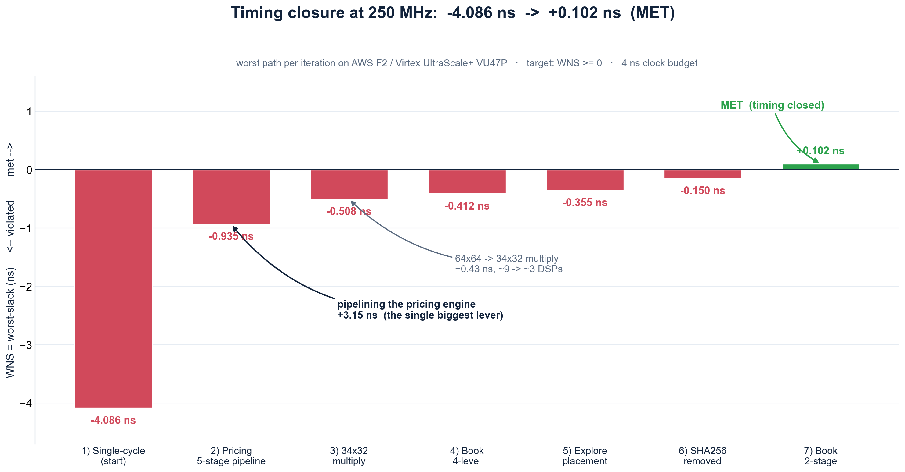

# Timing closure: −4.086 ns to +0.102 ns

At 250 MHz every path between two registers has 4 ns. The first full
data-plane build missed that by more than the whole budget. Six changes
closed it.

| Step | Change | Worst slack |
|---|---|---|
| start | — | −4.086 ns |
| 1 | Pricing engine split into 5 pipeline stages | −0.935 ns |
| 2 | Skew multiply narrowed from 64x64 to 34x32 | −0.508 ns |
| 3 | Order book reduced from 8 levels to 4 | −0.412 ns |
| 4 | "Explore" placement strategy | −0.355 ns |
| 5 | SHA-256 / HMAC removed from the silicon build | −0.150 ns |
| 6 | Order book pipelined into 2 stages | **+0.102 ns** |

## Step 1: pipelining without changing the answer

The single-cycle pricing engine chained a clamp, a multiply, a rounding shift,
two subtractions and a saturation: about 8 ns of logic. Splitting it into five
registered stages leaves each stage well inside the budget. The operations,
their order and the rounding are unchanged, so the result is bit-identical;
only the valid flag is delayed by the same five cycles.

## Step 2: the multiplier nobody asked for

The operands of the skew multiply had been declared 64 bits wide out of
habit. The tools built what was written: a 64x64 multiplier with a long carry
chain behind the DSP blocks.

The values never needed it. Inventory is clamped to the position limit, which
fits in 34 signed bits, and the skew parameter is 32 bits. Declaring the
operands at their real widths removed most of the carry chain. The product is
the same number.

The lesson generalises beyond FPGAs: a type wider than the data is not free.

## Step 5: the honest trade

The parameter block carries an HMAC so the chip can reject a block that did
not come from the host. The SHA-256 core is correct and passes its testbenches,
including the FIPS test vector. It also made placement harder for everything
around it. For the hardware demonstration it was left out, and the README says
so. Putting it back means pipelining the core further or moving the check off
the critical clock domain.

## An observation

After step 2 the remaining gap shrank slowly, a few percent of the clock
period at a time, and no single path stood out. That pattern usually means the
design is near what the placer can do, and the next gain comes from structure
(step 6) rather than from tuning.
